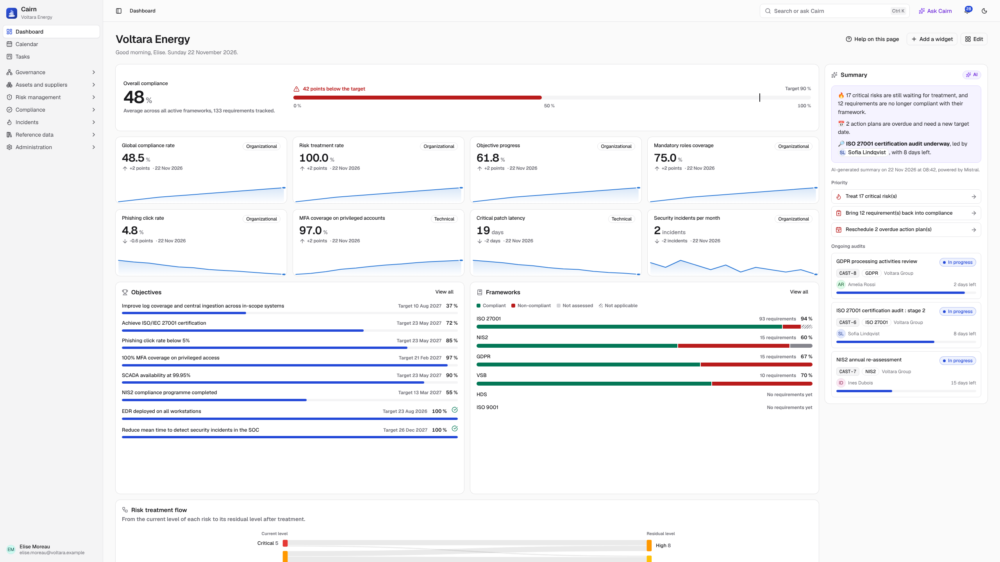
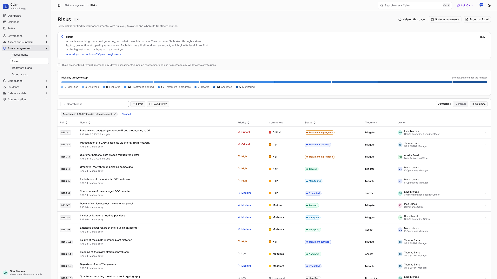
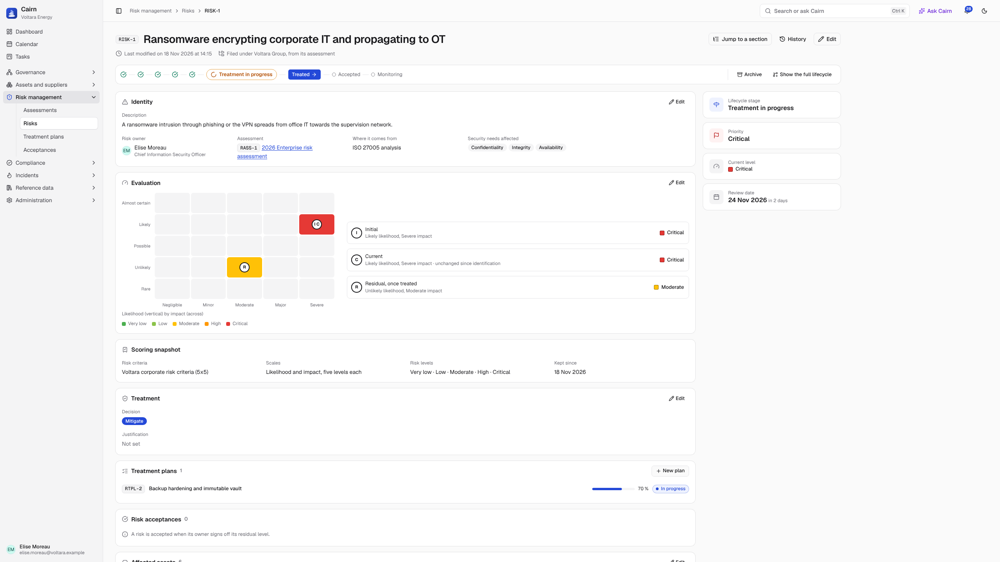
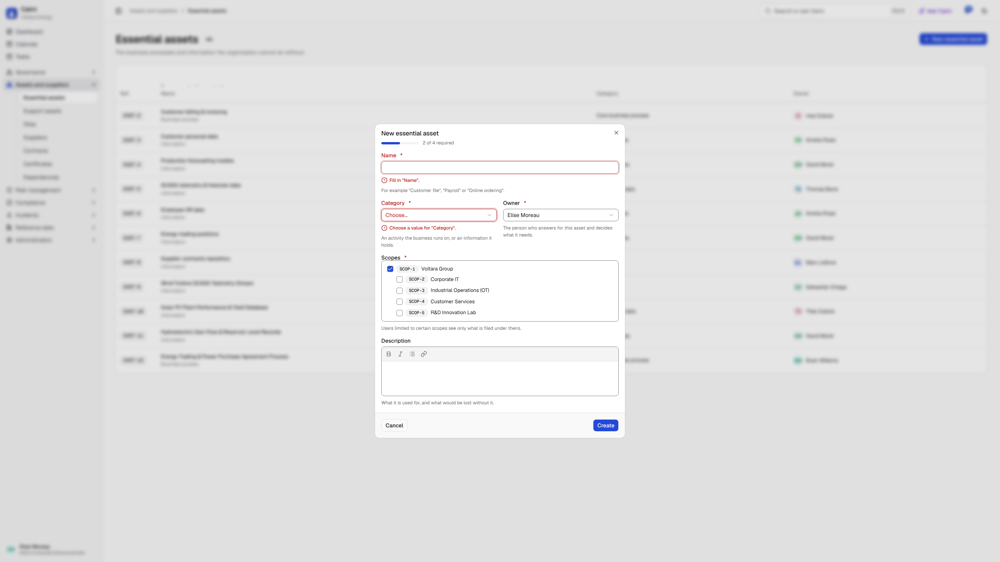
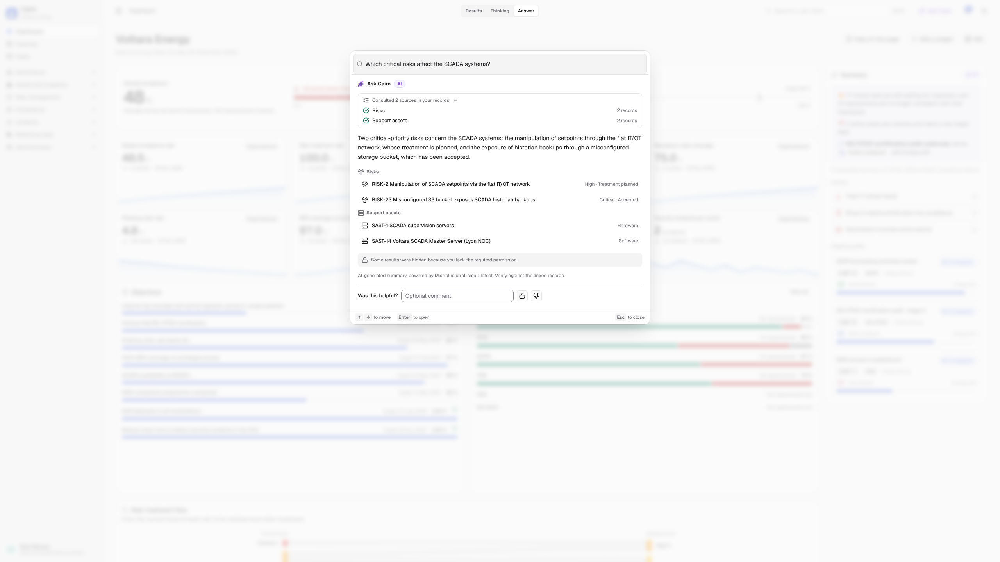

# Redesign proposal

**Status : proposal, awaiting a decision.** Nothing in the application has
changed yet. This page records the choice of component library, the new
visual identity and five mockups; the migration roadmap at the end is
executed once the choice is made.

- Mockups, interactive (light and dark, desktop and phone) :
  [claude.ai artifact](https://claude.ai/artifact/Ew6XoYFZjdTmPpaAkoh3Jf)
  (private to its owner until shared), or open
  `docs/brand/redesign/mockups/index.html` from a checkout.
- Visual system : [brand guidelines v2](brand-guidelines-v2.md).
- Tokens : [theme/cairn-theme.css](theme/cairn-theme.css).

## Why

The interface works but is monotonous, and its system has drifted.

- Every card has the same weight, KPI tiles carry a coloured left border,
  text is small, wide screens leave large empty bands, section titles are in
  capitals, red-amber-green bars repeat everywhere, and a record page shows
  two competing blue buttons (*Edit* and the lifecycle transition).
- Bootstrap 5.3.8 is restyled by 6 004 lines of Cairn CSS in 11 stylesheets;
  templates add 34 `<style>` blocks, 273 `style=` attributes and 260
  hard-coded colours. The brand guidelines contradict the code on a dozen
  points (icon version, table headers, title weight).
- The logo is pasted as inline SVG eleven times in six templates, and the
  login page still shows the favicon of the product's former name.

## What "component libraries made for AI" means

The expression covers two different families.

1. **Components for AI interfaces** : conversation, reasoning, sources.
   [AI Elements](https://elements.ai-sdk.dev/docs) (Vercel) is "built on top
   of shadcn/ui", needs React 19, Next.js and Tailwind 4, and is deprecated at
   the end of November 2026 in favour of shadcn/ui, which ships 21 AI Elements
   patterns since [October 2026](https://ui.shadcn.com/docs/changelog/2026-10-ai-elements)
   after its [conversation layer](https://www.infoq.com/news/2026/08/shadcn-conversational-primitives)
   of August 2026. prompt-kit and assistant-ui are React as well. None of
   them covers a whole GRC application (registers, forms, records) and none
   runs without React : they cover the conversational part only.
2. **Libraries built to be read by AI agents** : shadcn/ui states the
   principle ("AI-Ready: Open code for LLMs to read, understand, and
   improve", [docs](https://ui.shadcn.com/docs)) and has an official MCP
   server; Basecoat, daisyUI and Tabler publish an `llms.txt`; Flowbite and
   IBM Carbon have MCP servers, and Carbon has an
   [AI label](https://carbondesignsystem.com/components/ai-label/usage/)
   component for AI-generated content.

[Basecoat](https://basecoatui.com/introduction) joins both : it is shadcn/ui
rewritten in plain HTML and CSS, including the conversation components
(`message`, `bubble`, `marker`, `attachment`, `shimmer`, `trace`,
`code-block`, `command`), so the AI patterns of shadcn/ui become usable in
Django templates.

## Options compared

Versions, licences and monthly downloads read on the npm registry on
2026-11-22. All five can be served by the instance, without a CDN.

| Option | AI side | Migration cost | Look | Limits |
| --- | --- | --- | --- | --- |
| **Basecoat 1.2.1** (shadcn/ui without React, MIT) with Bootstrap's grid and utilities. **Recommended** | AI components in HTML, `llms.txt`, the visual language of shadcn/ui's AI Elements | Medium : components change, layout stays | Modern, typographic, sober without coldness | Young : 1.0 on 2026-06-27, one npm maintainer, 165 000 downloads a month |
| daisyUI 5.8.2 (MIT) | `llms.txt` as a skill, paid MCP server, `chat-bubble` | Medium | Many themes, playful by default | 1.18 MB prebuilt stylesheet; not shadcn's AI patterns |
| Tabler 1.7.5 (MIT, Bootstrap 5 inside) | `llms.txt` and agent skill, no AI component | Lowest : same classes | Classic administration dashboard | Little character of its own |
| Web Awesome 3.15 (web components, MIT free tier) | None | High | Polished, neutral | Shadow DOM complicates theming and the axe audit; Pro components are paid |
| IBM Carbon (web components) | AI label and explainability popover, MCP server | High | Very corporate, dense | Built React first, strong IBM identity |

Repainting the current Bootstrap layer was set aside : it is what produced the
monotony and the drift.

## Recommendation

- **Components** : Basecoat 1.2.1, *Nova* style, as its prebuilt stylesheet
  and vanilla scripts, declared in `core/dependencies.py` like Bootstrap
  today. Checked : the prebuilt stylesheet holds the components and the
  theme, so **no Tailwind build is needed** and the "No build step" rule of
  `docs/sdk/ui-conventions.md` holds.
- **Layout** : `bootstrap-grid.min.css` and `bootstrap-utilities.min.css` from
  the same Bootstrap 5.3.8 package (checked : no `.btn`, `.card`, `.table`,
  `.badge` in them), so the utility classes of the templates keep working.
- **Theme** : shadcn/ui variables plus Cairn's status and AI tokens, light and
  dark ([cairn-theme.css](theme/cairn-theme.css)); Geist and Geist Mono
  (OFL-1.1); Lucide icons (ISC).
- **AI presence** : an AI label with an explainability popover (an idea from
  Carbon for AI) on the text the model wrote and on nothing else; tools
  consulted shown as a trace of labels and counts; records as sources.

Points checked while building the mockups :

- Basecoat's Jinja `dialog` and `command` templates hold 5 inline `onclick`
  handlers, forbidden by Cairn's Content Security Policy, and its `toast`
  script accepts an `onclick` string. The mockups use Basecoat's classes and
  scripts only, and open dialogs through a registered action, as
  `window.cairnActions` does.
- Full Bootstrap and Basecoat both define `.btn`, `.card`, `.badge`, `.table` :
  they cannot share a page, hence the two shells of the roadmap.
- Basecoat's reset sets headings to the body size, removes list markers and
  link colours, and makes SVG block-level : the theme restores what Cairn's
  pages need (`@layer base` in the theme file).

## Two decisions taken while building

- **Nova rather than Rhea.** The plan named Rhea (a compact *Luma*). A side by
  side render showed that Rhea fills inputs with the input border colour
  (`bg-input/50`), which makes a 3:1 control boundary impossible, and draws
  pill buttons and 24 px card corners that read as a consumer app. Nova keeps
  compact spacing, 8 to 12 px corners and outlined fields.
- **Cool neutral greys.** The first round used the warm *stone* greys; they
  read yellowish in the light theme and brownish in the dark one, and were
  replaced by the neutral *zinc* greys. No surface is tinted yellow or brown :
  warning badges carry their colour on the text, dot and border only, empty
  matrix cells are neutral, and the treatment flow's bands are grey.

## The five mockups

Built on the Voltara Energy demo data (the seed run into a scratch database),
for Elise Moreau, with the product's real rules : the lifecycle bar, create
short, an assistant that only reads. Renders at 2560 x 1440; the dark
versions sit beside them in `docs/screenshots/redesign/`.

**1. Dashboard** : Elise's widget layout, the *Summary* widget with the AI
label on the model's text only, compliance against its target, indicators,
objectives, frameworks, treatment flow, current and residual matrices.

**2. Risks** : lifecycle distribution as a filter, saved filters, priority and
level as two separate words, *Not assessed* for an unrated risk, row actions
in a menu, density setting; no creation button, as risks come from
assessments.

**3. Risk page (RISK-1)** : the lifecycle bar with *Treated* as the only
filled button, the level journey (initial, current, residual) on the matrix,
every card editable on its own, traceability as one line.

**4. New essential asset** : the five fields of the real creation form, the
owner already filled in, named errors, helpers that say what the label does
not, *Cancel* and *Create*.

**5. Ask Cairn** : the command palette in three states (results, waiting,
answer); the answer shows the sources consulted, a one-or-two-sentence
summary with no identifier, the records, the permission note, the
disclaimer and the feedback form.

Dark theme : [dashboard](../../screenshots/redesign/01-dashboard-dark.png),
[risks](../../screenshots/redesign/02-risks-dark.png),
[risk page](../../screenshots/redesign/03-risk-detail-dark.png),
[new essential asset](../../screenshots/redesign/04-new-essential-asset-dark.png),
[Ask Cairn](../../screenshots/redesign/05-ask-cairn-dark.png).

### What the mockups add to the product

Restyling apart, these are new behaviours, to be specified before they are
built :

- a top bar holding the breadcrumb, the search, *Ask Cairn* and the
  notifications;
- a greeting under the dashboard title;
- the lifecycle distribution bar of the risk register;
- a density setting on registers;
- the trace of the tools the assistant consulted;
- the next lifecycle transition as the only filled button of a record page;
- an indicator's change written in points for a percentage (*+2 points*);
- *No requirements yet* instead of an empty 0 % bar for a framework.

Wordings kept as the product writes them today, though worth a look : the
register's page title says *Risk register* where the menu and the page help
say *Risks* (the mockup uses *Risks*), and the dashboard links read
*Treat 17 critical risk(s)*.

### How they were checked

- Contrast of every text token on every surface it can sit on, both themes :
  no pair under 4.5:1, control boundaries and focus ring over 3:1 (table in
  the guidelines).
- axe-core 4.10.3, the version of the CI, with the WCAG 2.2 A and AA rules of
  `scripts/a11y_audit.py` : 0 violation and 0 script error on the index and
  the five mockups, light and dark, at 2560 x 1440 and 390 x 844.
- Chart palette validated for colour-vision deficiencies on Cairn's card
  surfaces.

## Migration roadmap

Executed after the choice, on its own branch and pull requests.

**Structure.**

- *Two shells during the migration* : `base.html` (Bootstrap) and a Basecoat
  shell; the tags of `core/templatetags/ui.py` render the variant of the
  active shell. Lots are cut by family of pages (shell, components,
  templates, icons and tests together), and every lot passes the full suite,
  the interface sweep and `scripts/a11y_audit.py` in both themes.
- *Guidelines first* : the first lot promotes the v2 guidelines to
  `docs/brand/brand-guidelines.md` and rewrites the brand rules of
  `CLAUDE.md`; `ui-components.md` and `ui-conventions.md` change with each
  component.
- *Tests with their lot* : 89 assertions on Bootstrap classes in 32 test
  files, 6 tests that read the stylesheets, the selectors of
  `scripts/a11y_audit.py`, and `core/tests/markup_audit.py`, which must count
  `data-on-click` among the attributes that make a link act.

| Lot | Content | Measured size |
| --- | --- | --- |
| M0 Foundations | Dependencies (Basecoat, Bootstrap grid and utilities, Geist, Lucide); theme file; `.dark` class set by the six theme resolvers alongside `data-bs-theme`; `--bs-*` triplets; company accent split into fill, label and text ink; old token names aliased for the stored Trust Center CSS (`--accent` mapped onto `--primary`); `test_contrast.py` on the new tokens | 1 token file, 6 resolvers |
| M1 Shell | Basecoat sidebar fed by `core/navigation.py`, top bar, command palette, toasts, phone layout | `base.html`, 3 691 lines |
| M2 Components | 30 components and 31 includes; `#itemDrawer` and `modal_form.html` (extended 67 times) as a native `<dialog>`; 14 modals, 20 `data-bs-toggle`, 40 `data-bs-dismiss`, 12 listeners on Bootstrap events (two of them HTMX triggers), 21 calls to Bootstrap's JavaScript; the widget gallery stays non-modal | 61 files |
| M3 Templates | A versioned rewrite script for button, alert, card and table classes, the widget constants of 14 Python files and the JavaScript that builds Bootstrap markup; Tom Select and pell hooked on data attributes instead of `.form-select` and `.form-control`, Tom Select's dropdown inside the dialog; then the `<style>` blocks, `style=` attributes and hard-coded colours | 329 templates |
| M4 Icons | A `` tag over a Lucide sprite, a mapping of about 330 names (HTML, Python, JavaScript), the stored icons of scopes and Trust Center measures with their validator, default and MCP schema : a public contract change, with `generate_docs` | 1 996 classes in 361 files |
| M5 Data | Dashboard (`templates/home.html`, edit mode, settings dialogs), widgets, ECharts theme, sparklines, matrices, dependency graph and calendar on tokens; kanban; EBIOS RM workshops | 16 widgets |
| M6 Standalone screens | Login, activation, MCP authorisation, onboarding, errors, public Trust Center; favicon, web manifest, application icon; WeasyPrint PDFs; DOCX and PPTX constants | 6 shells, 3 PDF templates |
| M7 Removal | Full Bootstrap stylesheet and script, Bootstrap Icons, GitLab Sans, the 11 legacy stylesheets | 3 dependencies |
| M8 Evidence | `/styleguide/`, the 40 documentation screenshots recaptured, README | 40 screenshots |

## Sources

- AI Elements, documentation and deprecation notice : https://elements.ai-sdk.dev/docs
- shadcn/ui, principles : https://ui.shadcn.com/docs
- shadcn/ui, October 2026 changelog (AI Elements) : https://ui.shadcn.com/docs/changelog/2026-10-ai-elements
- InfoQ, shadcn/ui conversational primitives (August 2026) : https://www.infoq.com/news/2026/08/shadcn-conversational-primitives
- Basecoat, introduction, installation and customization : https://basecoatui.com/introduction
- Basecoat, customization (styles, themes, fonts, icons) : https://basecoatui.com/customization
- IBM Carbon for AI, AI label : https://carbondesignsystem.com/components/ai-label/usage/
- daisyUI with the Tailwind standalone executable : https://daisyui.com/docs/install/standalone/
- Tabler : https://github.com/tabler/tabler
- Web Awesome, frequently asked questions : https://webawesome.backerkit.com/faq
- Lucide licence : https://lucide.dev/license
- Geist licence : https://github.com/vercel/geist-font
