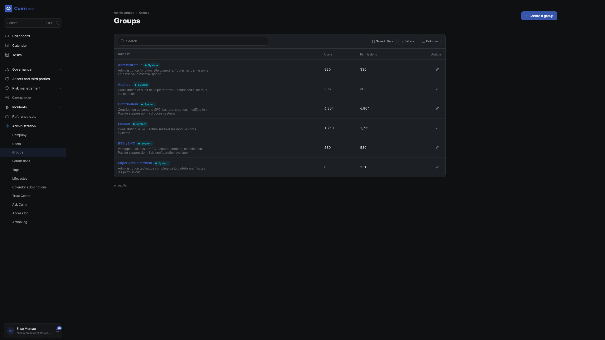
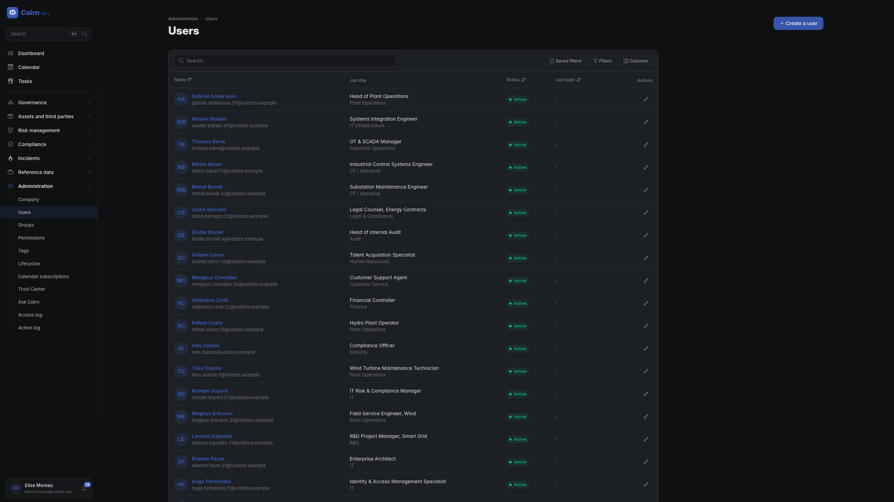
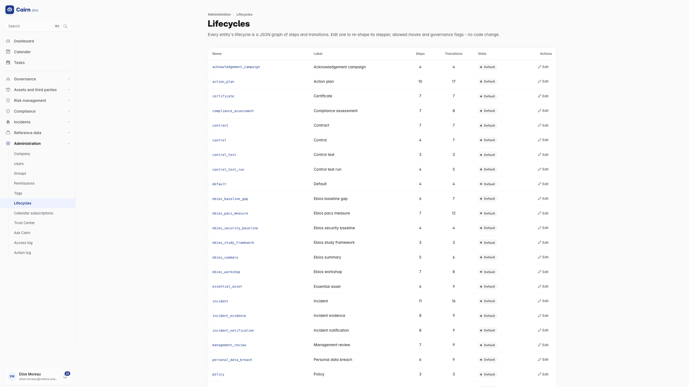

# Administration

Everything under the Administration section. Most of it is visible only to those
holding the relevant permissions.

## Company

Name, application name, the assistant's name, address, accent colour, and
whether your logo replaces the Cairn one. This is what appears in the interface
header and on generated reports.

## Users

Users sign in with their **email address**; there is no username.

**Inviting** is the normal way to add someone. The account is created with no
password and the invitee receives a single-use activation link to set their
first credential. No administrator ever types someone else's password, and no
endpoint accepts one on their behalf.

A user is assigned **groups**, which grant permissions, and **scopes**, which
decide which records they see. Both matter, and they are independent : the right
permissions on the wrong scopes still shows an empty list.

**Impersonation** lets an administrator act as another user, which is the fastest
way to answer "why can't they see this". It is recorded in the access log at both
ends, so it is a traceable act rather than an invisible one.

## Groups and permissions

Six groups ship with the platform, from Super Administrator down to read-only
roles. A group's permission set is a **filter** over the permission catalogue
rather than a hand-maintained list, which is why a newly added permission lands
in the right groups automatically.

Permissions are named `module.feature.action` : `risks.risk.update`,
`incidents.evidence.read`. The action is one of create, read, update, delete,
access or approve. **Approve** is the one that gates lifecycle transitions, so a
user who can edit a risk but not approve it can prepare work without validating
it. That separation is usually the point.

The complete catalogue is in the
[permissions reference](../reference/generated/permissions.md).

Custom groups are the normal case for a real organisation. Start from the
shipped group closest to the role and adjust.

On a group's page the permissions are listed module by module. Each module is
a line showing how many of its permissions the group holds (`12 / 40`); open
it to read or change them, by cell, by row, by column or all at once, or use
*Expand all*. Saving applies the whole matrix, whatever is open.

## Lifecycles

Administration -> Lifecycles lets you edit the steps and transitions of any
lifecycle : rename a step, add one, change what requires a comment, change which
permission gates a transition.

Treat this as a governance change rather than a settings change. Adding a step
changes what "validated" means for every existing record of that type. See
[how records move](lifecycles.md).

## Agent skills

Administration -> Agent skills holds the procedures of your organization written
for the AI assistants connected to Cairn over MCP : how you onboard a supplier,
who approves a risk acceptance, what to check before closing an incident. An
assistant reads a skill the way a newcomer reads a procedure, and follows it
with the tools it names.

1. **Create the skill** with its name (lowercase words joined by hyphens, for
   example `supplier-onboarding`) and its description : what it does and when an
   assistant should use it. The description is all an assistant reads before
   it chooses the skill.
2. **Write its instructions** on its page, in Markdown : the steps, the tools to
   call at each one, what to ask the user.
3. **Submit it, then validate it.** Only a validated skill is served : what it
   says becomes instructions for the assistants, so someone holding the
   approval permission reads it first. Once validated, a connected assistant
   lists it beside the skills Cairn ships, and its client asks the user to
   approve the new version.

Cairn ships skills of its own (how to work with Cairn, an ISO 27005 risk
analysis, a compliance assessment), listed at the bottom of the register. A
skill of yours that bears the same name **replaces** it for the whole instance
while it is validated; archiving yours brings the shipped one back.

## Tags

The reusable labels assignable to any record in any module. Managed centrally so
the vocabulary stays shared rather than each person inventing their own.

## Calendar subscriptions

Issues personal iCal feeds so users can see Cairn deadlines in Outlook, Google
Calendar or Apple Calendar. Each subscription is a token that can be revoked.

## Trust Center

Settings for the public page, and the queue of **document requests** to review
and approve. See [Trust Center](trust-center.md).

## Ask Cairn feedback

The thumbs up and down users left on assistant answers, with the original
question and the model's response, exportable for analysis. Only present when
the assistant is enabled.

## Logs

**The access log** records authentication and account events : successful and
failed logins, logouts, token refreshes, password changes, lockouts, passkey
registration and use, invitations, activations, and impersonation start and
stop.

**The action log** records what was done in the application.

Both are the audit surface. An account locked after five failed attempts,
an impersonation session, a passkey registered from an unfamiliar device : this
is where you see them.

## Imports

Bulk import is available where the data usually starts life in a spreadsheet:
compliance frameworks from Excel, suppliers from CSV.

Import is not a merge tool. Review what a file will create before running it on
a populated instance, particularly for frameworks, where a second import of the
same standard produces a second framework rather than updating the first.
