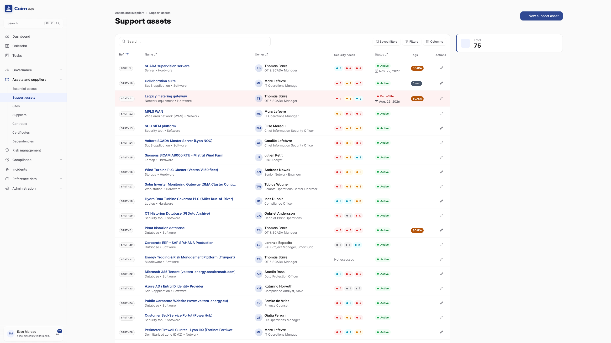
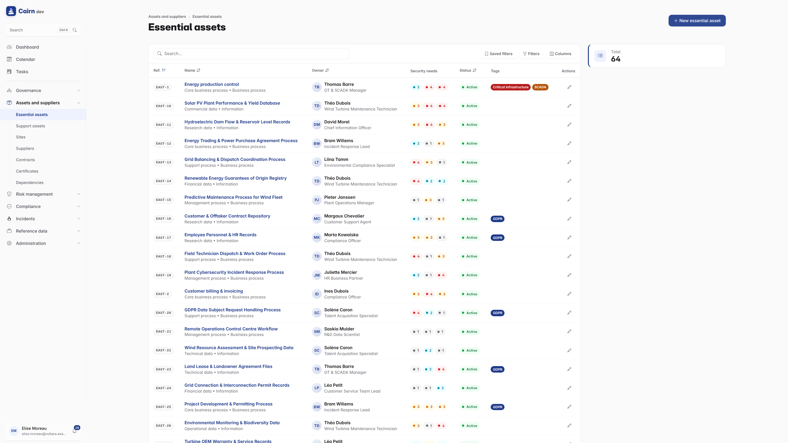
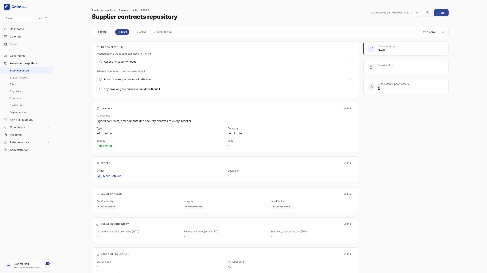
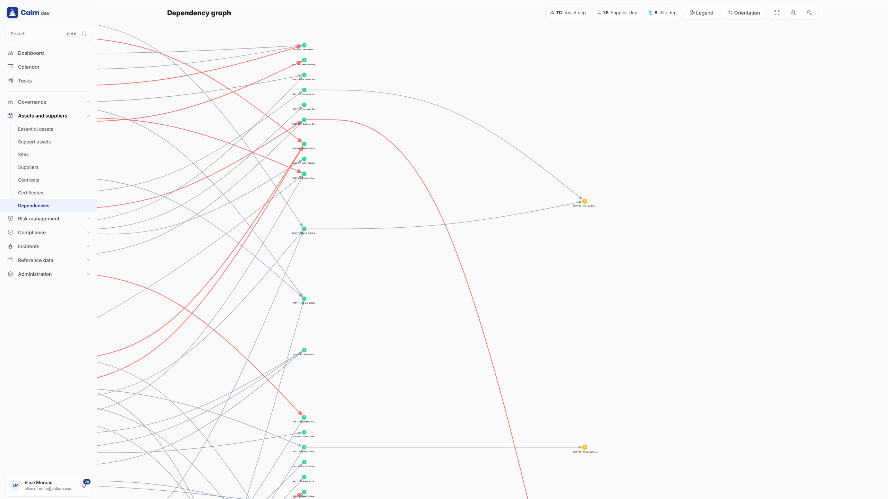
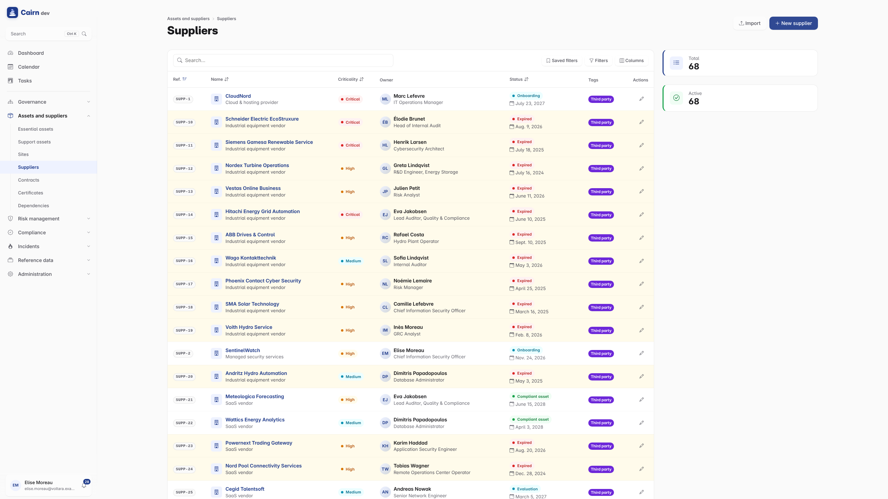
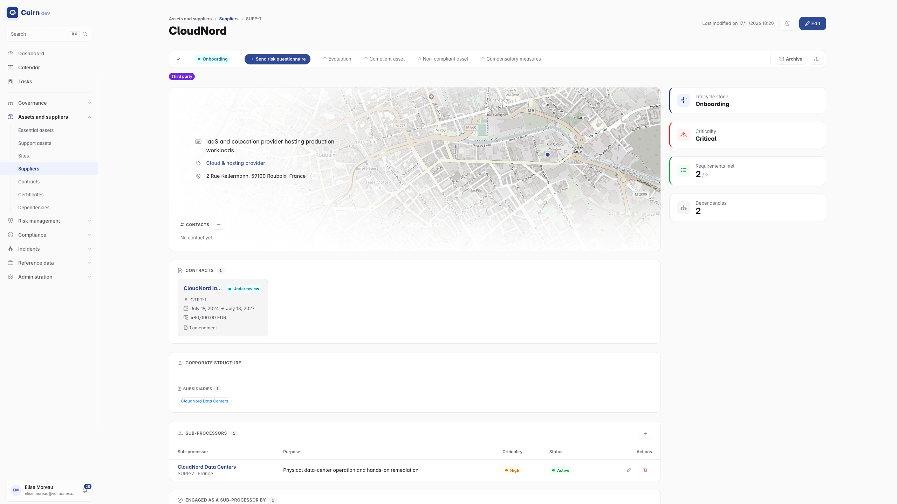

# Assets and suppliers



## The two kinds of asset



Cairn separates what the business depends on from what carries it, and the
separation is the point rather than a taxonomy exercise.

**Essential assets** are business processes and information : the payroll
process, the customer database, the SCADA telemetry. They are what a risk is
ultimately about. Each is valued on three criteria, **confidentiality,
integrity and availability**, on a five-level scale. That valuation is a
business judgement and it is where the whole model gets its weighting.

**Registering one takes one screen** : its name, its category (an activity the
business runs on, or an information it holds) and who answers for it. You land
on its page, which lists what it still needs.



Its **security needs** are not asked at creation, and they have no default :
until somebody answers the three questions (what if it were disclosed, wrong,
out of reach ?) they read *Not assessed*, and the asset cannot become
*Active*. Answering them from the *Security needs* card records who decided
and when, in the history at the bottom of the page. A level is shown with its
word (*High*), not its number.

**Support assets** are what carries them : servers, applications, networks,
services bought from a supplier, paper archives, people. They have a lifecycle
of their own : end of life, end of support, warranty expiry.

**Registering one takes one screen too** : its name, its category (*Server*,
*Database*, *Hosting service*... grouped under the type it belongs to, which
you no longer choose) and who answers for it. Its page then suggests what makes
the record useful : say which essential assets rely on it, where it runs and
how exposed it is, and when it stops being supported. None of it holds its
lifecycle back. The rest (serial number, host name, contract, the asset it is a
part of) is filled card by card, when you have it.

## Dependencies, and why they earn their keep

A dependency links an essential asset to the support assets it relies on, with a
criticality and a redundancy indication. There are four kinds : asset to asset,
asset to supplier, site to asset, site to supplier.

Two things fall out of the graph, and they are the reason to build it.

**Inherited security needs.** A support asset automatically inherits the
highest confidentiality, integrity and availability levels of the essential
assets that depend on it. You value the business process once, and the
criticality of the server underneath it is derived rather than argued about.
Until an essential asset relies on it, or while none of them is assessed, its
needs read *Not assessed* : unknown, which is not the same as negligible.

**SPOF detection.** Cairn continuously identifies single points of failure :
where one support asset or one supplier carries something critical with no
redundancy. The count is on the dashboard, and the detail names the dependency.
A SPOF you have accepted is a decision; a SPOF you did not know about is an
outage waiting for a Tuesday.



The **dependency graph** renders all of it visually, which is usually how
somebody first notices that three critical processes rest on one virtualisation
host.

## Asset groups

Logical groupings of support assets, for when the same treatment applies to a
set rather than to individuals. Create the group with its name and its type,
then pick its members from the *Members* card of its page.

## Sites

Physical and logical locations : offices, datacenters, cloud regions, and they
are hierarchical. A site runs an operational lifecycle rather than the default
one:

```
Draft ──▶ Commissioning ──▶ Operational ──▶ Review
                                              │
                            Decommissioned ◀──┘
```

Sites participate in dependencies, so "which processes stop if this datacenter
does" is a question the graph answers.

A site is seen by the people whose scopes include it (from the *Sites* card of
a scope) or under which it is filed.

## Suppliers



The third-party register, and the part of the module most often driven by a
regulator rather than by choice.

A supplier carries its contacts, its mapped addresses, its subsidiaries, and its
**sub-processors** : the parties your supplier in turn relies on. That last one
is what supply-chain mapping under NIS2 and DORA actually requires, and it is
why the field exists rather than a free-text note.



**Supplier types** carry requirements, and a supplier is evaluated
**per requirement** with an evidence review rather than given a single overall
score. "Compliant" as a single verdict is not defensible; "compliant on twelve
of fourteen requirements, with these two under remediation" is.

Suppliers can be **bulk imported from CSV**, which matters when the register
starts as a spreadsheet somebody has been maintaining for three years.

**Registering a supplier by hand takes one screen** : its name, what it
provides, who answers for the relationship, and how critical it is. That last
answer is yours : nothing is selected for you. Its page then suggests what
makes the record useful (a contact, where it is established, what relies on
it), and each card (identity, coordinates, relationship) has its own *Edit*.

## Documents

**Contracts** are multi-party : suppliers on one side, customer stakeholders on
the other. They carry amendments, supersession (which contract replaced which),
an attached PDF stored securely rather than on a share, and a lifecycle of
Draft, Active, then Expired or Terminated.

**Certificates** are your own : the ISO 27001, HDS or SOC 2 certificates your
organisation holds. Each is attached to the framework it attests, with the
certification body, validity dates, the sites it covers, its renewal history and
the PDF.

Certificates are what the [Trust Center](trust-center.md) publishes, so keeping
them current here is what keeps the public page honest.

Both are registered on one screen (a title, who or what it concerns, its dates
and the PDF) and completed card by card on their page, which says what is
still worth adding : the end date of a contract, the body that issued a
certificate.

## A workable order

1. **Activities** first, in [organisational context](organisational-context.md).
2. **Essential assets**, attached to those activities, valued on CIA.
3. **Support assets**, the infrastructure.
4. **Dependencies** between them. This is the step people skip, and it is the
   one that makes CIA inheritance and SPOF detection work.
5. **Suppliers**, with their types and requirements.
6. **Contracts and certificates**, attached to the suppliers and frameworks that
   already exist.
