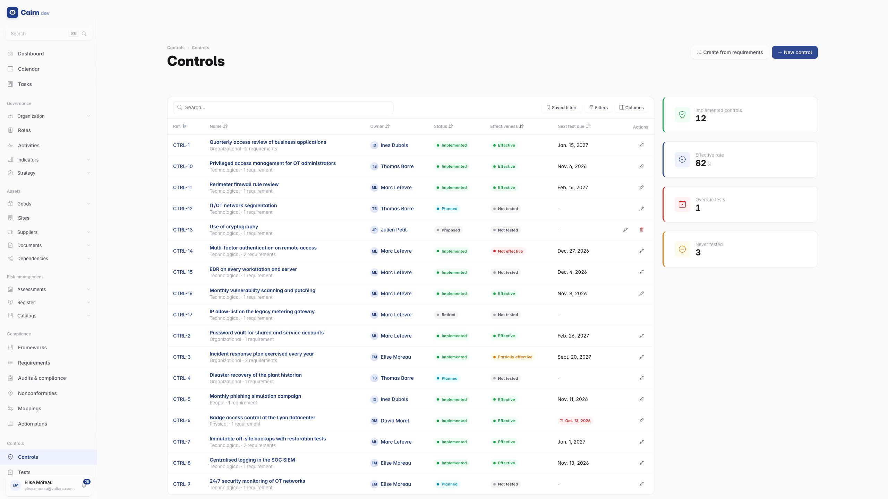
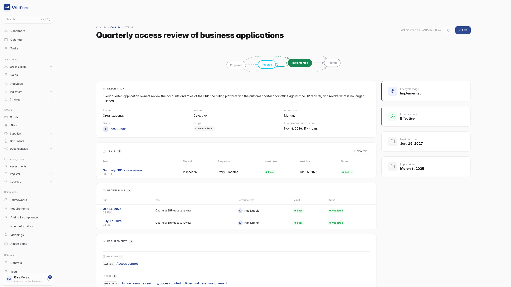
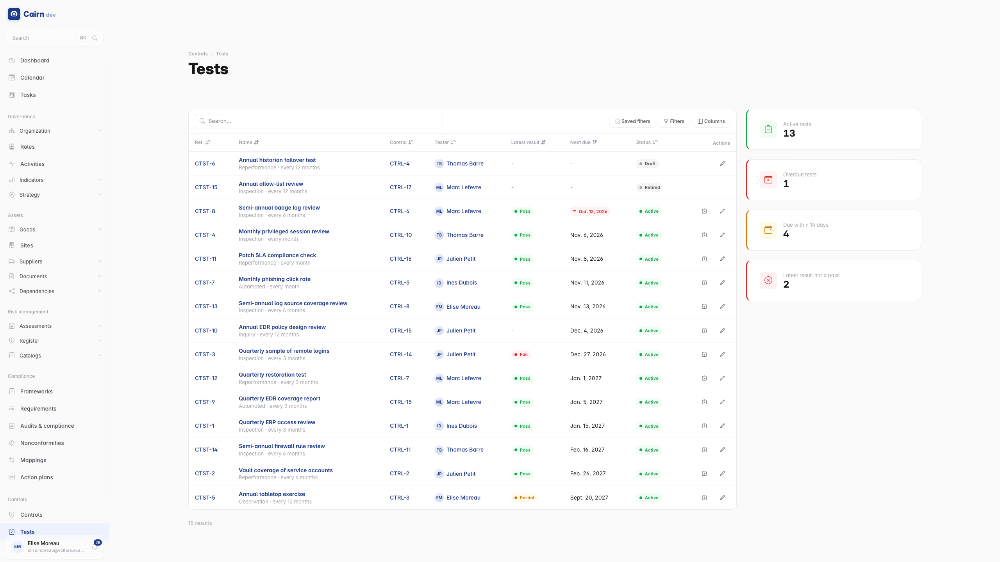

# Controls

The register of your **security controls** : what the organisation actually
does to meet its requirements and treat its risks, such as "multi-factor
authentication on every remote access", "quarterly access review of the ERP"
or "encrypted off-site backups". For every control it answers what an auditor
asks of the Statement of Applicability and of clause 9.1 : what does the
organisation do for this requirement, is it implemented, who owns it, how do
you know it works, and when was it last tested.

Open it from the **Controls** section of the sidebar, between Compliance and
Documents : *Controls* is the register, *Tests* is every test of every control
with its next due date. Both entries appear only if your group can read them.

## A control

A **control** is a durable practice, not a task. It has a name, a description
of how it operates day to day, an ISO/IEC 27002:2022 **theme** (organizational,
people, physical, technological), a **nature** (preventive, detective,
corrective), an **automation** level, an owner and the scopes where it applies.

It is linked to everything it serves, from any module :

- the **requirements** it satisfies, from any framework at once (one control
  can answer ISO/IEC 27001 A.8.5, NIS2 article 21 and a customer clause);
- the **risks** it treats, and the **treatment plans** and EBIOS RM **PACS
  measures** that create or reinforce it;
- the **support assets** it applies to, the **objectives** it contributes to,
  and the **documents** that describe it (a procedure, a standard).

The pickers offer the elements you can currently link. A link to an element
outside your scopes is kept when you edit the control, even though you do not
see it. Each of these elements shows the controls linked to it on its own page.

## Its lifecycle

A control is **proposed** first. Once the organisation has decided on it, it is
**planned**; once it operates, it is **implemented** (most controls already
operate when the register is first filled, so a proposed control can be
declared implemented directly). Declaring it implemented records the
implementation date, today by default; you can set an earlier date on the
control, never a later one. If the practice stops or regresses, send it back
to planned with a comment : the implementation date and the history keep the
record.

A control is **retired** with a comment, which also retires its active tests.
A retired control stays visible on the pages it was linked to, flagged as
retired, and drops out of the Statement of Applicability and every indicator.
Only a proposed control without tests can be deleted.

These moves go through the lifecycle stepper at the top of the page, as
everywhere in Cairn. See [How records move](lifecycles.md).

## Effectiveness is derived, never declared

A control's **effectiveness** is computed from the latest validated run of each
of its **active** tests :

| Effectiveness | When |
| --- | --- |
| Not effective | the latest validated run of an active test failed |
| Partially effective | none failed, and the latest validated run of an active test was partial |
| Effective | every active test has a validated run, and every latest one passed |
| Not tested | no active test, or an active test has no validated run yet |

Nobody types it in : it changes when a run is validated or withdrawn, and when
a test is activated or retired. When a test of the control is **overdue**, the
control keeps its last effectiveness but its page says it rests on an overdue
test, so a stale result is never mistaken for a current one.

## The control register

The list shows, for every control, its owner, its state, its effectiveness, the
next test due (red when a test is overdue) and the number of requirements it
satisfies. The rail counts the implemented controls, the effective rate
(effective controls among the tested ones), the overdue tests and the controls
never tested. Filter on the theme, the nature, the owner, the scope, the state,
the effectiveness, or on the controls with an overdue test.

### Create controls from requirements

To bootstrap the register from a framework already in Cairn (the ISO/IEC 27001
Annex A, for instance), use **Create from requirements** : choose the
framework, and the drawer lists its applicable requirements that no control
covers yet, all ticked. Untick the ones you do not want and save : Cairn creates
one **proposed** control per ticked requirement, named after it, with its
description as a starting point, the framework's scopes and the requirement
linked. A requirement that already has a control (even a retired one) is
skipped and reported : re-covering it is a decision, not a bulk action.

## The control page

The rail shows the lifecycle stage, the effectiveness, the next test due and
the implementation date. Below it :

- **Description** : how the control operates, its theme, nature, automation,
  owner and scopes.
- **Tests** : every test with its method, frequency, latest result and next
  due date. **New test** adds one.
- **Recent runs** : the latest runs of all its tests, whatever their state.
- **Requirements**, grouped by framework.
- **Risks and treatment** : the risks with their residual level, the treatment
  plans and the PACS measures. Cairn does not compute a risk's residual level
  from its controls : the assessor sets it, and this card is its justification.
- **Applies to**, **Objectives** and **Documents**, then the traceability card.

## Tests

A **test** says how a control is checked : its method (inquiry, observation,
inspection, reperformance or an automated check), the **procedure** the tester
follows, the **acceptance criteria** (what a pass looks like), how often it runs
(every 1 to 36 months), and the default tester. A test with no pass criterion
proves nothing, so a test can be **activated** only once its control is planned
or implemented and it has a procedure and acceptance criteria.

The **next due date** of an active test is derived : the date of its latest
validated run plus its frequency, or, before any run, the first due date you set
(the activation date otherwise). A test is **overdue** when that date has
passed; its tester (else the control owner) is reminded before and after.
Retiring a test, with a comment, removes it from the effectiveness and from the
due dates; its runs stay readable.

The **Tests** register lists every test with its control, tester, latest result
and next due date, filtered on the due window (overdue, due within 14 days,
later), the tester, the latest result and the scope.

## Runs

Each time a test is performed, **Record a run** on the test page. The form
opens with the test's tester as performer and today as the date. A run records
who tested, when, the period covered, the sample, the result (pass, partial,
fail), the observations and the **evidence** files.

While the run is **in progress**, everything can change : attach evidence with
**Add evidence** (an export, a screenshot, a signed review sheet, 25 MB at
most), remove a file, edit the result. Each file's size and **SHA-256** are
recorded at upload, and the file is only ever downloaded through Cairn, with
your permissions and scopes checked.

**Submit for review** freezes the run : it needs a result, and a partial or
failed result needs observations. From then on its result, observations and
evidence can no longer change on any surface; a reviewer can send it back to
in progress, with a comment, to reopen it. The run is **validated** by a
reviewer who did **not** perform it (segregation of duties, which applies to
administrators too). Validating it updates the test's next due date and the
control's effectiveness at once. A validated run found unreliable is
**withdrawn** with a comment, which recomputes both again.

### Raise a finding

A validated **partial** or **failed** run can raise one finding in the
[nonconformity register](compliance.md) : **Raise a finding** on the run page
asks for the finding type (major or minor nonconformity, or observation) and an
optional recommendation. The finding takes the run's observations as its
description and the control's requirements as its related requirements, and
links back to the run. Once raised, the run page shows it instead of the
action.

## Permissions

| Permission | Lets you |
| --- | --- |
| `controls.control.read` | Read the register and the controls' links |
| `controls.control.create` | Create a control, including from requirements |
| `controls.control.update` | Edit a control's identity and links, send it back to planned |
| `controls.control.approve` | Plan, declare implemented, retire a control |
| `controls.control.delete` | Delete a proposed control |
| `controls.test.read` | Read tests, runs and evidence |
| `controls.test.create` | Create a test, record a run |
| `controls.test.update` | Edit a test or a run in progress, add or remove its evidence, submit a run |
| `controls.test.approve` | Activate or retire a test, validate, send back or withdraw a run, raise a finding |
| `controls.test.delete` | Delete a draft test or a run in progress |

The register follows your [scopes](organisational-context.md#scopes) : a
control is visible only within the perimeters it is filed under, and its tests,
runs and evidence follow it.

## Elsewhere in Cairn

- The Statement of Applicability lists, for each applicable requirement, its
  controls with their state and effectiveness. See [Reports](reports.md).
- The requirement, risk, treatment plan, support asset, objective and document
  pages show the controls linked to them.
- The exact rules the module enforces are in the
  [Controls specification](../specs/m8-controls/README.md).
