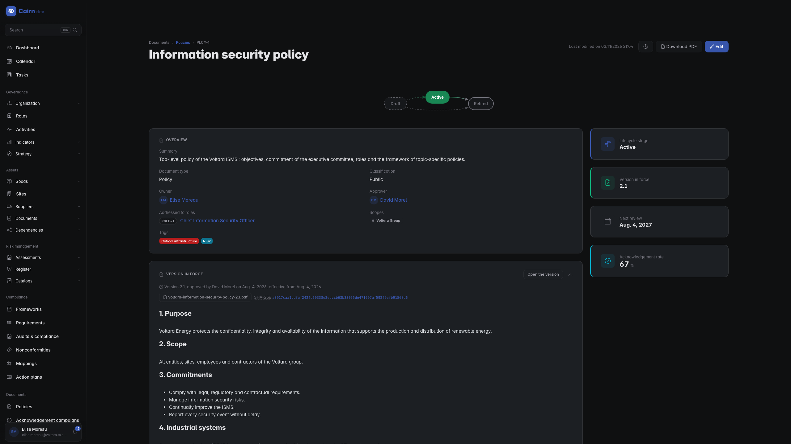
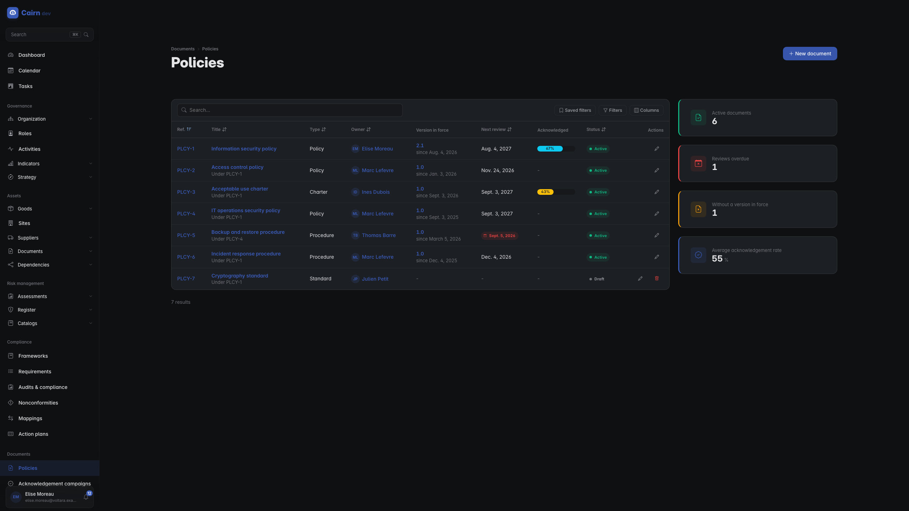
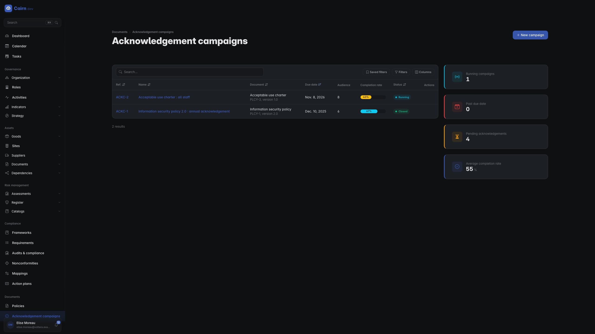
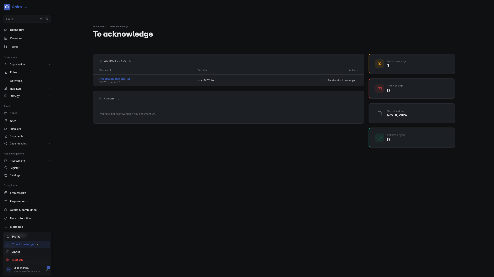

# Documents

The register of your **documented information** (ISO/IEC 27001 clause 7.5) :
the information security policy, the topic-specific policies, and the
procedures, standards and charters that implement them. For every governing
document it answers the four questions an auditor asks : which version is in
force, who approved it and when, when it is next reviewed, and who has
acknowledged it.

Open it from the **Documents** section of the sidebar, between Compliance and
Incidents : *Policies* is the register, *Acknowledgement campaigns* is who was
asked to read what. Both entries appear only if your group can read them.

## A document and its versions

A **document** is an identity : a title, a type (policy, procedure, standard,
guideline, charter, plan), a classification, an owner, an expected approver, a
review frequency, the scopes it governs, the roles it is addressed to and the
requirements it answers. You edit that identity freely while the document is
in use, and every change lands in its history.

Its **content** lives in its **versions**. A version holds the text of the
document, a PDF (the signed copy), or both. You write and change a version only
while it is a **draft**. The moment it is submitted for review it is **frozen** :
the text that gets approved is the text that stays on record, and neither the
form, the API nor the assistant can change it afterwards. If a reviewer wants a
change, they send the version back to draft, with a comment.

Approving a version **puts it in force**. The approval stamps who approved it and
when, the effective date defaults to the approval date, and the version that was
in force until then becomes **superseded** in the same step. There is never more
than one version in force, and superseded versions stay readable : clause 7.5.3
asks you to keep obsolete documented information, and the register does it for
you. A superseded version's page says which version replaced it and when.

Creating a document creates its first draft version with it, so the drawer asks
for the first version's label, its text and its PDF in its last step. A document
becomes **active** when its first version is put in force; until then it is a
draft and can still be deleted. An active document is never deleted : you
**retire** it through its lifecycle, with a comment, which also supersedes its
version in force and closes its open campaigns.

All these moves go through the lifecycle stepper at the top of each page, as
everywhere in Cairn. See [How records move](lifecycles.md).

## The document page

The rail shows the lifecycle stage, the version in force, the next review date
(red when it has passed) and the completion of the latest acknowledgement
campaign. Below it :

- **Version in force** : the approval line ("approved by ... on ..., effective
  from ..."), the PDF with its **SHA-256**, and the rendered text.
- **Versions** : every version on record, with its state, approval, effective
  date and change summary. **New version** drafts the next one.
- **Review** : the review cycle, and the **Reviewed, no change** action.
- **Structure** : the parent document and the documents under it.
- **Requirements** : what the document answers, for example A.5.1 or
  clause 5.2. The requirement pages in [Compliance](compliance.md) link back.
- **Acknowledgement campaigns** : who was asked to read which version.

**Download PDF** serves the attached PDF when there is one, and otherwise
renders the text of the version to a PDF. To check that a copy someone hands you
is the approved one, compute its SHA-256 and compare it with the value on the
page.

## A new version

**New version** on the document page proposes the next label : a minor revision
(1.2 becomes 1.3) or a major one (1.2 becomes 2.0). The new draft starts from
the content and the PDF of the version in force, with an empty change summary,
and opens straight away. From the second version on, the change summary is
required before you can submit : a reviewer has to know what changed and why.

## The review cycle

The **next review date** follows the version in force : its effective date plus
the review frequency, unless the owner sets an explicit date on the document.
A document past that date is **overdue for review**; the register flags it in
red, the list has a filter for it, and the owner and the approvers are reminded.

Two things close a review cycle :

- putting a new version in force, when the review leads to a change;
- **Reviewed, no change**, when it does not. It records who reviewed the
  document, when and with which note, and moves the next review date on. It
  needs the approval permission on documents.

## The register

The *Policies* list shows, for each document, its type, owner, the version in
force and since when, the next review date and the completion rate of its
latest campaign. The rail counts the active documents, the overdue reviews, the
documents without a version in force and the average acknowledgement rate. The
filters cover the state, the type, the owner, the scope and the review status.

## Acknowledgement campaigns

A campaign asks a defined audience to confirm they have read **one version in
force** : the A.5.1 evidence that a policy was communicated to and acknowledged
by the people it concerns, and the clause 7.3 evidence of awareness.

1. Create the campaign from the document page (**New campaign** on the
   *Acknowledgement campaigns* card) or from the campaigns list. Pick the
   version, a due date, an optional message, and the **statement** people
   confirm. `{title}` and `{label}` in the statement are replaced by the
   document title and the version label.
2. Define the audience : named users, groups, roles. A campaign created from a
   document starts with the roles that document is addressed to.
3. **Launch** it through the stepper. The audience is resolved **once, at
   launch** : one row per active person, each notified. A later change to a group
   does not silently change who was asked.

While the campaign runs, its page shows the audience with each person's status
(to acknowledge, acknowledged, excused, expired), when they acknowledged and
through which channel, with filters on the status.

- **Add newcomers** re-resolves the audience on demand and adds the people who
  have joined the groups or roles since the launch.
- **Excuse** takes a person out of the campaign, for a leaver or a long absence,
  with a mandatory reason. The row is kept, and the completion rate leaves it
  out.

**Close** the campaign when it is over : the rows still pending become expired
and the completion rate is frozen. When the version a campaign targets is
superseded, its campaign closes by itself. A campaign for the new version is a
new campaign.

The completion rate is the acknowledged rows divided by all rows less the
excused ones.

## To acknowledge

Every user, whatever their permissions, finds **To acknowledge** in the user
menu at the bottom of the sidebar, with the number of documents waiting for
them. The page lists what is waiting, soonest due first, and what you
acknowledged before.

Opening a request shows the campaign's message, the document itself (its text,
and its PDF when there is one) and the statement. **Acknowledge** records your
confirmation with the time, the channel and the statement as you confirmed it.
It cannot be changed, withdrawn or deleted afterwards, and nobody, not even an
administrator, can acknowledge on your behalf : only the person a request is
addressed to can answer it.

## Permissions

| Permission | Lets you |
| --- | --- |
| `documents.policy.read` | Read the register, the versions and their PDFs |
| `documents.policy.create` | Create a document and its first version |
| `documents.policy.update` | Edit a document, draft a new version, edit and submit a draft |
| `documents.policy.approve` | Approve and put a version in force, send one back, activate or retire a document, record a review with no change |
| `documents.policy.delete` | Delete a draft document or a draft version |
| `documents.acknowledgement.read` | Read the campaigns, their audience and completion |
| `documents.acknowledgement.create` | Create a campaign |
| `documents.acknowledgement.update` | Edit a draft campaign, close a running one, add newcomers, excuse a person |
| `documents.acknowledgement.approve` | Launch and archive a campaign |
| `documents.acknowledgement.delete` | Delete a draft campaign |

Acknowledging your own request needs no permission.

The register follows your [scopes](organisational-context.md#scopes) : a
document, its versions and its campaigns are visible only within the perimeters
it is filed under. Your own requests to acknowledge are always visible to you.

## Elsewhere in Cairn

- A document can be published on the [Trust Center](trust-center.md), which
  always serves its version in force.
- The [management review](reports.md) links ISMS changes to the documents they
  affect and lists the documents due for review in the period.
- The exact rules the module enforces are in the
  [Documents specification](../specs/m7-documents/README.md).
