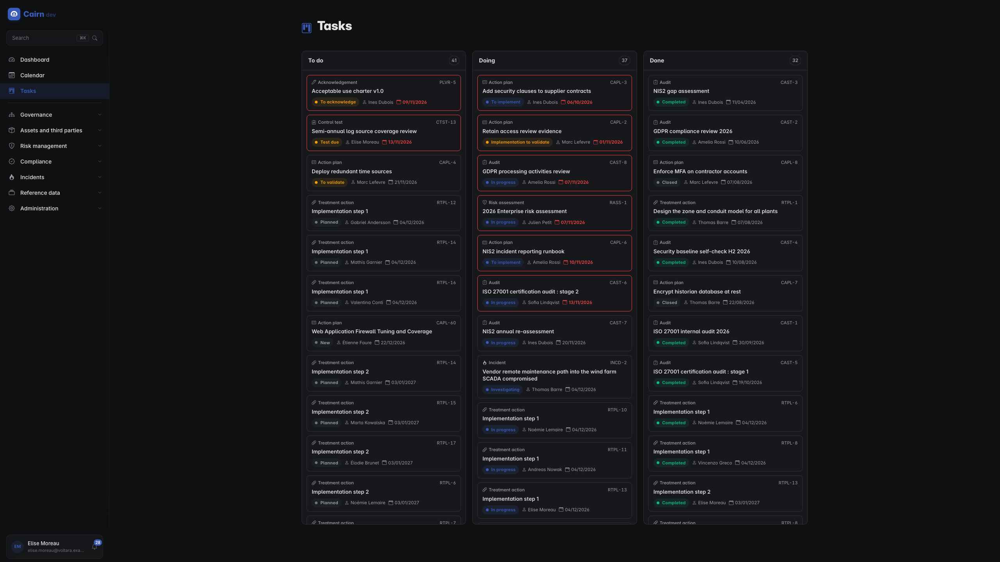
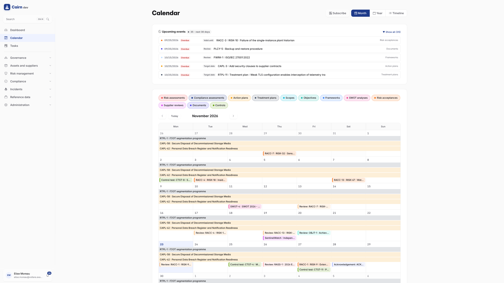

# Finding your way

## The sidebar

Three links you use every day (the dashboard, the calendar, your tasks), then
one section per area of work. A section opens on its pages : there is nothing
nested inside it. What you see depends on your permissions : a page you cannot
open is absent rather than disabled, and a section with nothing for you is not
shown at all.

| Section | Pages |
| --- | --- |
| **Governance** | Scopes, issues, stakeholders, objectives, SWOT analyses, roles, activities, indicators, management reviews, reports |
| **Assets and third parties** | Essential assets, support assets, sites, suppliers, contracts, certificates, dependencies |
| **Risk management** | Assessments, risks, treatment plans, acceptances |
| **Compliance** | Frameworks, requirements, audits, nonconformities, action plans, controls and their tests, policies and acknowledgement campaigns |
| **Incidents** | Incidents, security events, notification obligations, response plans |
| **Reference data** | What the registers draw on, set up once and rarely opened : asset groups, supplier types, risk criteria, threats, vulnerabilities, requirement mappings, reporting authorities, obligation templates |
| **Administration** | Company, users, groups, permissions, tags, lifecycles, calendar subscriptions, Trust Center, Ask Cairn, the access and action logs |

Sections are **folded by default**, and only one is open at a time : the one
holding the page you are on, which stays marked while you are on one of its
records. Opening another folds the previous one, so the menu never grows back
to the whole product tree. There is nothing to set up and nothing to remember :
the open section always follows where you are.

Two entries cover several lists of the same subject. **Indicators** opens on
the organizational ones and **Dependencies** on those between assets; a row of
links under the page title switches to the other views (technical indicators;
supplier, site and graph views of the dependencies).

Every page carries a breadcrumb built from this same tree, so a detail page
always tells you where it sits : `Governance > Organization > Stakeholders >
STKH-1`.

## Global search

The search box in the header looks across every module you have access to :
scopes, assets, risks, requirements, incidents, suppliers, and the rest. Results
are grouped by type, and they are filtered by your permissions and scopes, so
search never reveals a record a list would have hidden.

Searching by **reference** is the fastest way to reach a known record. Every
record carries one, and they are stable : `RISK-42`, `INCD-7`, `ASST-15`.

## The command palette

The palette is the keyboard route to anything. Open it from the header, type,
and it matches both navigation targets and records.

If [Ask Cairn](ask-cairn.md) is enabled, the palette also takes **questions** in
plain language : "Which decisions were made at the last management review?".
The answer cites real records, and it can only cite records you were already
allowed to read.

## The tasks board

A single To do / Doing / Done board that aggregates the work items scattered
across modules : compliance action plans, risk treatment actions, audits, risk
assessments and incidents. It is the answer to "what is actually on my plate",
which no single module can give you because the work is spread across five of
them.

The board is deliberately **read-only**. There is no drag-and-drop, because a
card's column is derived from the real record's status or lifecycle step, and
moving work is a governed transition that belongs on the record's own page where
the permission gate and the comment requirement live. Click a card to go there.

Cancelled and archived items drop off the board entirely rather than piling up
in a fourth column.

## The calendar

Dated obligations, in one place : review dates, audit windows, target dates,
acceptance expiries, notification deadlines. Each kind of record has its
colour, shown as a tint and a rule on the left of the event; the chips above
the grid show or hide a kind.

It can be **subscribed to** rather than merely read. Administration -> Calendar
subscriptions issues a personal iCal feed you can add to Outlook, Google
Calendar or Apple Calendar, so deadlines appear where you already look for them.
The feed is tied to a token; revoking the subscription invalidates it.

## Lists, filters and sorting

Every list supports search, column sorting and filtering. Two behaviours are
worth knowing.

**Sorting is remembered.** Your choice of column and direction is stored on your
account per list, so a list you always read by target date stays that way across
sessions and devices.

**Filters can be saved.** A filter combination you use repeatedly can be named
and kept, and optionally shared with everyone. Saved filters turn "the query I
rebuild every Monday" into one click.

## Notifications

The bell in the header. Cairn notifies you about things that need a decision
from you : an element pending validation, a Trust Center document request. It
does not notify you about everything that changes, which is deliberate : a
notification stream nobody reads is worse than none.

## History

Every record has a **History** view showing its complete change trail : field
differences, approvals and lifecycle transitions, with who and when.

This is not a debugging aid, it is the audit surface. When an auditor asks
"who validated this and on what date", this is the screen that answers.

## Themes and language

The theme follows your operating system by default, and can be pinned to light
or dark from your profile. The language is English or French, stored on your
account.

Note that the **data** is not translated. A requirement written in French stays
in French for an English user; only the interface changes.

## Keyboard and readability

The first press of `Tab` on any page offers **Skip to main content**, which
jumps over the sidebar, and the element that has the focus is always outlined.
Links, buttons, menus and forms work from the keyboard; on the dashboard, the
arrow buttons of a tile do what dragging does. Texts meet the WCAG 2.2 AA
contrast level in both themes, status badges included, whatever accent colour
your organisation has chosen.

## About this instance

**About**, at the foot of the sidebar, opens a small dialog stating the version
you are running, the licence (AGPL-3.0-or-later) and where the source code is.

Expand **Open source libraries** to see the third-party components Cairn is
built on, grouped into backend, frontend and development tooling. Each one
carries the version this instance actually runs and links to its official
repository, which is what an auditor asking for a component inventory usually
wants.
