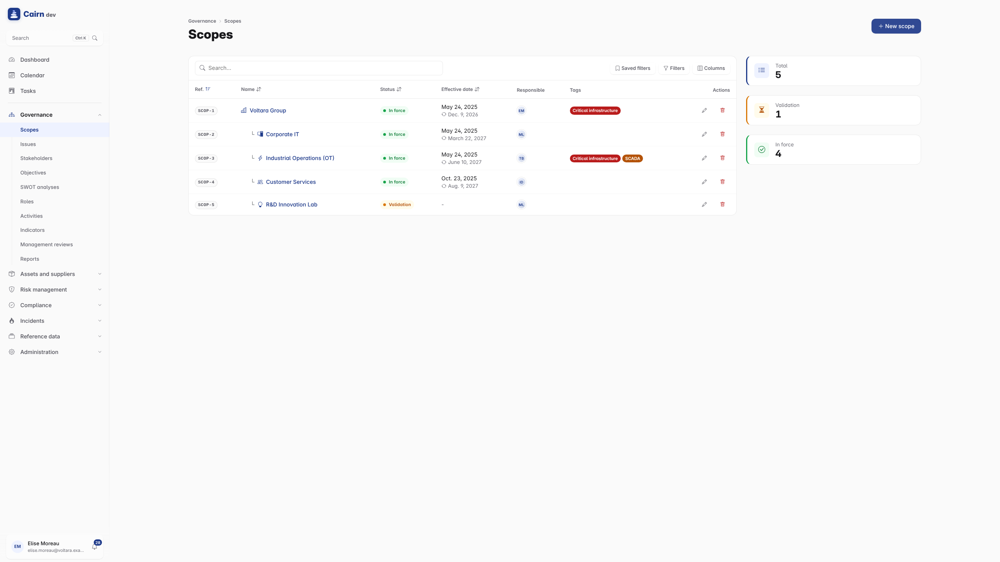
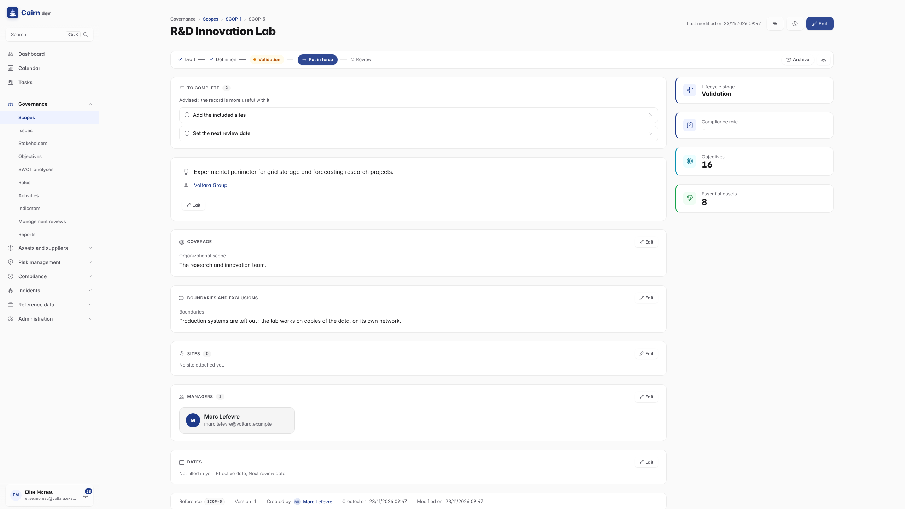
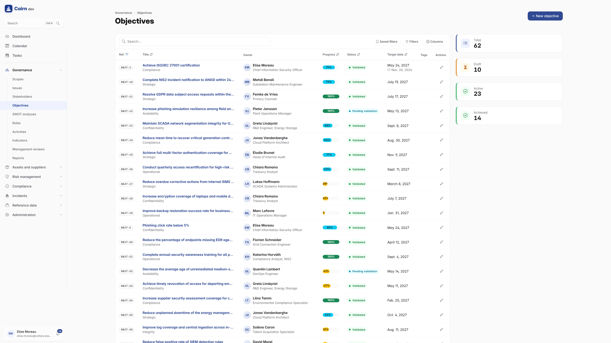
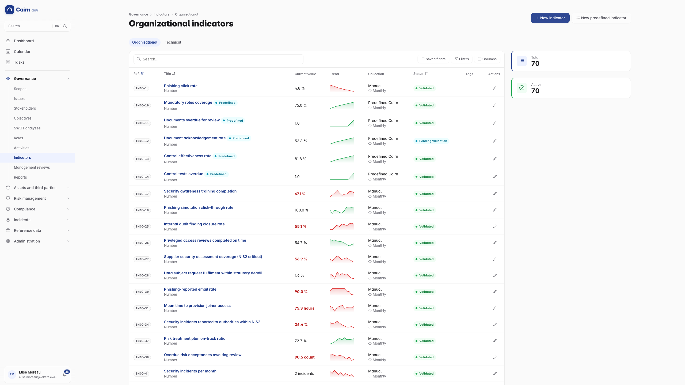

# Organisational context



ISO 27001 clause 4 asks you to establish the context of the organisation before
anything else : what you are protecting, who cares, and what you are trying to
achieve. This module is where that lives, and everything downstream attaches to
it.

## Scopes

A scope is an organisational perimeter : a subsidiary, a business line, a
certified domain. They are hierarchical, so a parent can contain children.

**Scopes are also the tenancy model.** A user is assigned scopes, and Cairn
filters what they see to those perimeters. This is why two colleagues can look
at the same list and see different counts. It is not a bug and not a caching
problem; it is the perimeter working.

A scope carries what a certification body will ask for : boundaries and
exclusions, the justification for those exclusions, the geographic,
organisational and technical extent, the applicable standards, an effective date
and a review date.

**Creating a scope takes one screen** : its name, a sentence or two on what it
covers, and its parent if it is part of another scope. You then land on its
page, which opens on a *To complete* list. Each line opens the dialog that
fills it; each card of the page (coverage, boundaries and exclusions, sites,
managers, dates) has its own *Edit* button, so you never walk the whole form to
change one thing.



Two lines of that list are **needed before the scope can be submitted** :
saying where it stops (write "no exclusion" when it covers everything) and
naming at least one manager. Until then the scope can be worked on, but
*Validation* and *In force* are refused, with what remains to be done. The
other lines (what it covers, its sites, its next review) are advised. The
effective date is filled in for you the day the scope comes into force.

It runs its own lifecycle rather than the default one, because a perimeter is
not simply approved or not:

```
Draft ──▶ Definition ──▶ Validation ──▶ In force ──▶ Review
                                            ▲            │
                                            └────────────┘
```

Only **In force** and **Review** count in reports and can be linked to. Review
loops back to In force, because a perimeter is re-examined periodically rather
than replaced.

Create at least one scope before anything else. A record created with no
perimeter has nowhere to live.

## Issues

The internal and external issues of clause 4.1, classified with PESTLE
(political, economic, social, technological, legal, environmental), each with an
impact level and a trend. The trend is what makes the register useful over time :
an issue whose impact is rising is a different management conversation from one
that is stable.

Noting an issue takes one screen : what the fact is, its category (picked under
*Internal* or *External*, which is how Cairn knows where it comes from) and how
much it weighs. Its page takes its trend and its next review, and reminds you
to say why it matters.

## Stakeholders

Interested parties and their expectations (clause 4.2), with influence and
interest levels so you can prioritise, and RACI support for who does what.

Expectations are recorded against the stakeholder rather than free-form, which
is what lets you answer "what did we commit to, and to whom" without rereading
minutes.

Adding a stakeholder takes one screen : who it is, and how much it weighs
(influence and interest are yours to decide : nothing is preselected). Its page
then asks first what it expects of you : *New expectation* adds one in four
answers, and each row can be edited or removed.

## Objectives



Security and business objectives with measurable targets : a target value, a
current value, and a progress percentage derived from the two.

An objective has two independent axes, and confusing them is the usual source of
puzzlement. Its **status** says how the work is going (active, achieved, not
achieved, cancelled). Its **lifecycle state** says whether the objective itself
is a validated commitment or a draft. An objective can be validated and not yet
achieved; that is the normal case.

Creating an objective takes one screen : what you aim at, what it serves, who
answers for it and for when. Its page then asks for the figure that says
whether it is reached, and for the issues it answers. You can also start from
an issue : once it is validated, its *Relations* card offers *New objective*,
and the objective you create there is linked to it. The pages of an issue and
of a stakeholder list the objectives linked to them.

## SWOT

Strengths, weaknesses, opportunities and threats, structured with impact levels
rather than as four free-text boxes. The structure is what allows a SWOT entry
to be cited from a management review.

Starting an analysis takes one screen : what it looks at, and when. You land on
its page, which reminds you to fill in the four quadrants and to set the next
review date.

## Roles

The ISO 27001 role assignments : who is the CISO, who is the DPO, who owns which
process. Roles can be marked **mandatory**, and the dashboard tells you when a
mandatory role has nobody assigned to it. An unassigned mandatory role is a
finding waiting to happen, and this is where you see it before the auditor does.

Roles also matter operationally : some lifecycle transitions are restricted to
whoever holds a given role for that record's perimeter. Assigning roles is what
makes those gates work.

Creating a role takes one screen : what it is called, what kind it is, and who
holds it. Its page then asks what it answers for : each responsibility is a row
you add there. Someone whose account was deactivated stays on the roles they
hold until you take them off.

## Activities

The business processes, hierarchical, classified as core, support or management,
each with a criticality level and an owner. The dashboard flags critical
activities with no owner, for the same reason as mandatory roles.

Activities are what essential assets attach to, so a well-built activity map
makes the asset inventory follow naturally.

Creating an activity takes one screen : what is done, how much it matters and
who answers for it. Its *Relations* card links it to the objectives it helps to
reach and the stakeholders it serves, and lists the essential assets it relies
on.

## Indicators



KPIs, split into **organizational** and **technical**. Each carries its
measurements over time, so an indicator has a history and a trend, not just a
current number.

Creating an indicator takes one screen : what you follow, whether it is a
number or a yes or no answer, who reads it and how often. Its page then asks
which level you expect, which objectives it tells the progress of, and for a
first reading, which you record there. Its thresholds fit its format : a number
falls below or exceeds a figure, a yes or no answer is true or false. *New
predefined indicator* is for the figures Cairn computes from its own records
(a compliance rate, the share of objectives on track) : you choose the source,
Cairn takes the readings.

Indicators are what the dashboard's Indicator widget displays. Because that
widget is reusable, you can place one tile per indicator you actually steer on,
rather than one list of everything you measure. See
[the dashboard](dashboard.md#placing-the-same-widget-twice).

## Tags

Reusable labels assignable to any record in any module, for the classifications
that cut across the model : "PCI scope", "2026 audit", "cloud". They are managed
under Administration -> Tags.
