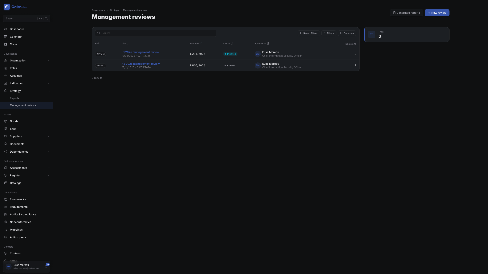

# Reports and management review

## Reports

The deliverables that leave Cairn and land in an auditor's inbox, generated from
live data rather than assembled by hand.

| Report | Format | Contents |
| --- | --- | --- |
| **Statement of Applicability** | PDF | Every requirement, its applicability, its justification and its status |
| **Audit report** | PDF | An assessment's findings, with the scope tree and per-requirement detail |
| **Risk register** | XLSX | The register with initial, current and residual levels, and treatment |
| **Meeting minutes** | DOCX / PPTX | Management review minutes and steering decks |

Two properties are worth relying on.

**Only records that count are counted.** A report includes what its lifecycle
marks as counting in reports, which is why a draft risk does not appear in the
Statement of Applicability. This is the same rule the dashboard uses, so the two
agree.

**Your perimeter applies.** A report is a read like any other and is filtered to
your scopes. Two people generating "the" risk register can legitimately produce
different documents.

Generated reports are listed under Governance -> Strategy -> Reports, so a
deliverable you produced last quarter is retrievable rather than regenerated
from data that has since moved.

**A report is filed under the scopes it was made from.** It is listed to, and
downloaded by, the people who are given **every** one of those scopes : a
report drawn from two perimeters is not opened by sharing one of them. A
report generated over the whole instance, by someone no scope restricts, is
read by those no scope restricts. Someone limited to scopes always finds the
reports they generated themselves, which hold what they could read.

## Management review

The ISO 27001 clause 9.3 management review, structured as the clause requires
rather than as a free-text meeting note.

A review has **participants** with roles, and it records:

**Stakeholder feedback** (clause 9.3.2.e), the formal input from interested
parties.

**Decisions**, each categorised, tied to the input clause that prompted it, with
a priority, an owner and a status. A decision that is recorded but never tracked
is a decision that did not happen, and this is what stops that.

**ISMS changes**, the change log the standard expects : what changed in the
management system, when, and why.

**Comments** on the record itself.

The review runs its own lifecycle, and can be cancelled from most steps with a
recorded reason.

**New review** asks the scopes whose data the review aggregates, its title,
its frequency (nothing is chosen for you), the period it covers and the date
it is held on; whoever plans it facilitates it. Its page then lists what the
closure waits for (an owner and a due date on every decision) and what is
advised : the approver, the agenda, the participants, the next review date
and, once the review is held, its executive summary. Each card has its own
**Edit**; the participants are listed on their own form, from the
*Participants* card.

Minutes are generated as a document, so the record in Cairn and the document
circulated afterwards come from the same source and cannot drift.

## The link to the rest

A management review is where the other modules converge : compliance status,
open nonconformities, risk posture, incidents and their post-incident reviews,
objective progress, stakeholder feedback.

The decisions it produces feed back out, into action plans, treatment plans and
ISMS changes. That loop closing, and being visible, is what an auditor is
looking for when they ask to see your management review.
