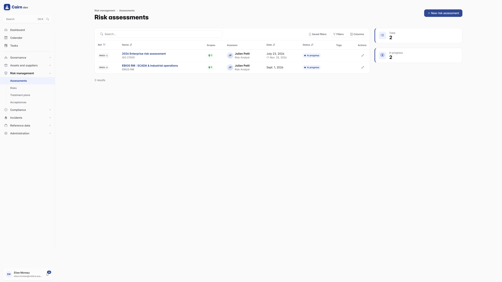
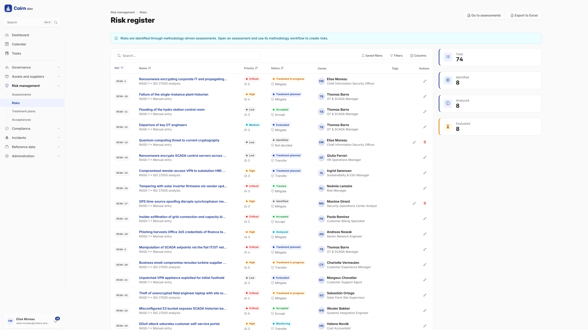
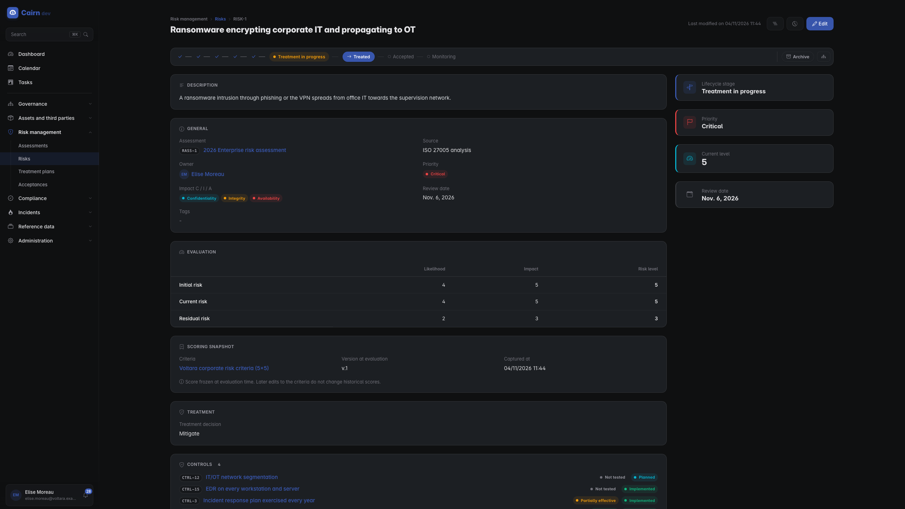

# Risks

Cairn supports two methodologies. **ISO 27005** is the classic
threat x vulnerability approach. **EBIOS RM** is the ANSSI method (version 1.5),
run as five workshops. Both feed the same unified risk register, so an
organisation can use one, the other, or both without ending up with two
disconnected registers.

Opening an assessment takes one screen : its name, its method (yours to choose :
nothing is preselected, because the method decides the screens the assessment
uses), who conducts it and the criteria its risks are rated on. Its page then
takes its dates and its summary, and says what it still needs.

## Criteria first

Risk criteria define the scales : the likelihood levels, the impact levels, and
the matrix that turns a pair of them into a risk level. Create them before your
first assessment, because they are what scores mean.

Editing criteria later does **not** rewrite scores already given. Each risk
keeps a frozen snapshot of the criteria it was scored under, so historical
scores stay meaningful and a matrix change does not silently rewrite last year's
audit. This is the right behaviour and it does mean two risks scored under
different criteria are not directly comparable.

## The register

A risk is tracked at **three levels** :

| Level | Meaning |
| --- | --- |
| **Initial** | Before any control |
| **Current** | With the controls actually in place today |
| **Residual** | After the planned treatment |

Each has its own likelihood and impact. The gap between current and residual is
the value your treatment plan claims to deliver, and the
[risk treatment flow](dashboard.md) widget on the dashboard visualises exactly
that movement.

A treatment decision is one of four : **accept**, **mitigate**, **transfer**,
**avoid**.

The page of a risk says what it still needs (its rating, its owner, its
treatment decision, what it would harm) and edits it one card at a time : each
card has its own *Edit*, so rating a risk does not mean walking through the
whole form.

## Catalogs

**Threats** are reusable, classified by type (deliberate, accidental,
environmental) and origin. **Vulnerabilities** are reusable too, with severity,
CVE references and remediation guidance.

Both run an approval lifecycle, so a catalog does not fill up with duplicates
somebody added in a hurry. A draft threat cannot be linked into an analysis
until it is validated.

Adding one takes one screen : what could happen and where it comes from for a
threat, what the weakness is and how severe for a vulnerability (the severity
is yours to decide : nothing is preselected). Its page then takes the rest,
one card at a time, and says what would make the entry useful.

## ISO 27005 analyses

An ISO 27005 analysis is an atomic scenario : one threat exploiting one
vulnerability against one asset. Likelihood and impact combine into a level
through the assessment's matrix.

Keeping scenarios atomic is what makes them re-usable and comparable. "Ransomware
affects the company" is not a scenario; "phishing (threat) exploits the absence
of MFA (vulnerability) against the payroll process (essential asset)" is.

Opening one, from the page of its assessment, asks for the threat, the weakness
and what the scenario would harm. You land on its page to rate it : each rating
is picked on the named levels of the assessment's criteria (*3 - Once a year*),
not typed as a bare number.

## EBIOS RM

The five workshops, in order, each building on the last.

Each workshop has its page, reached from the bar at the top of the study. The
page opens on a short **help** that says what the workshop produces and where
to start, with the words of the method explained (a *feared event*, a *risk
source*). What you add to a workshop is a row of its page : the form opens in
the side panel, asks a few fields, and brings you back to the page.

**Workshop 0, framing.** The study framework : the mission, the perimeters, the
participants and the constraints of the study.

**Workshop 1, the security baseline.** Work down the page :

1. **Business values and assets** : choose the activities and the essential
   assets the study protects, and the support assets they rely on. *Edit* on
   the card opens that part alone.
2. **Feared events** : *New feared event* asks for the essential asset, the
   security criterion (confidentiality, integrity or availability), a name and
   the **gravity**, picked by the name of its level on the impact scale of your
   risk criteria (*4 - Major*), or left as *Not assessed*. There is one feared
   event per essential asset and criterion, so the possibilities are enumerated
   rather than brainstormed; the page lists the essential assets that have
   none yet. Its description and the reasons for its gravity are added when
   you edit it.
3. **Baseline references** then **baseline gaps** : the frameworks you already
   apply, and the rules of theirs that are not met. *New baseline gap* asks for
   the rule, the gap and its severity; editing it links the compliance
   requirement and the support assets concerned, which is where the risk and
   compliance modules meet.

While something is missing, the page says so under **To complete**, and the
workshop cannot be validated until the study names its essential and support
assets and each essential asset has its feared event.

**Workshop 2, risk sources.** Who could attack you, and what for :

1. *New risk source* asks for a name, a category and three ratings, each picked
   by the name of its level : the **motivation**, the **resources** and the
   **activity** of the source. The first two give its threat level, from V1 to
   V4, on the grid of the method (Grid A); a rating may wait, and the source
   then reads *Not assessed*.
2. Under each risk source, *New targeted objective* adds a goal it pursues
   (lucrative, strategic, ideological...) and the feared events of workshop 1
   it would cause.
3. An objective and its risk source make a **pair (SR/OV)**. *New pair
   (SR/OV)*, on the line of the objective, asks how relevant the pair is : how
   credible it is that this source pursues this objective against you. Untick
   *Retained for workshop 3* on a pair you set aside, and say why.

The workshop cannot be validated until one pair is retained : the next
workshops study the retained pairs.

**Workshop 3, strategic scenarios.** The ecosystem cartography, where each
stakeholder is positioned by `(dependency x penetration) / (maturity x trust)`
and lands in a control, monitoring or danger zone. Then strategic scenarios
linking retained SR/OV pairs to feared events, with ordered attack path steps.

**Workshop 4, operational scenarios.** The technical detail : likelihood on the
ANSSI V1 to V4 scale, gravity inherited from the parent strategic scenario, and
attack techniques mapped to a shared **MITRE ATT&CK** catalogue. A heatmap shows
technique coverage. Operational scenarios are then consolidated into the unified
risk register, idempotently, so re-running the consolidation does not duplicate.

**Workshop 5, treatment.** A summary per assessment with the residual risk
strategy, the monitoring plan, the PACS narrative and before/after cartography
snapshots. **PACS measures** (governance, protection, defense, resilience,
awareness) link to treatment plans, baseline gaps and compliance requirements.

The six workshop progress trackers are created automatically on every EBIOS RM
assessment, so the workshop status is visible without anyone maintaining it.

## Treatment plans

Structured remediation : ordered actions, progress tracking, cost estimates, and
links to compliance action plans so the same work is not tracked twice in two
modules.

Open one from the page of the risk it treats (*New plan*) : it asks what will
be done, how (mitigate, transfer, avoid), by whom and for when. Its page then
takes its target, its cost and its actions, each added on one screen.

A plan whose target date passes is marked **overdue** automatically by a nightly
job. This only happens if your administrator has scheduled it; see
[operations](../technical/operations.md#scheduled-commands).

Treatment actions appear on the [tasks board](finding-your-way.md#the-tasks-board).

## Risk acceptance

Some risks are accepted, and accepting one properly is a formal act rather than
an omission.

An acceptance record carries who accepted, the conditions, an expiry date and a
review schedule, and it goes through a two-step approval. When `valid_until`
passes, the acceptance is marked **expired** automatically, and upcoming
expiries are reported ahead of time so somebody can act.

That expiry is the point. An accepted risk that nobody revisits is an accepted
risk that has quietly become an unmanaged one, and this is the mechanism that
surfaces it.

## Risk matrices

Two heatmaps, current and residual, each its own dashboard widget so you can
show one, the other or both. They are also generated into the risk register
report.
